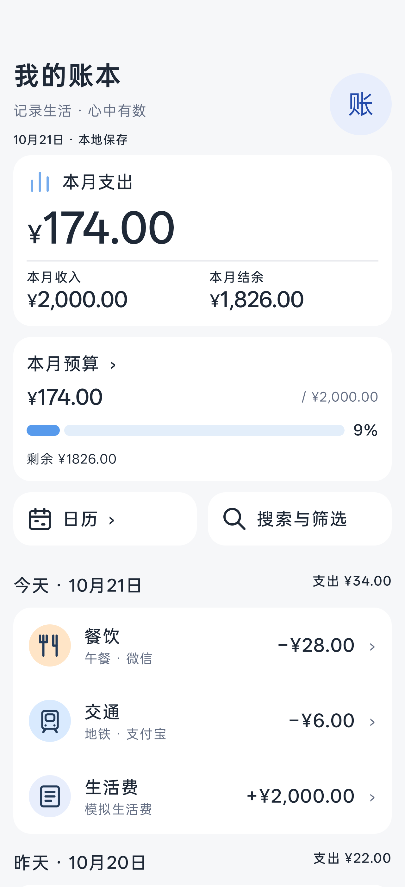
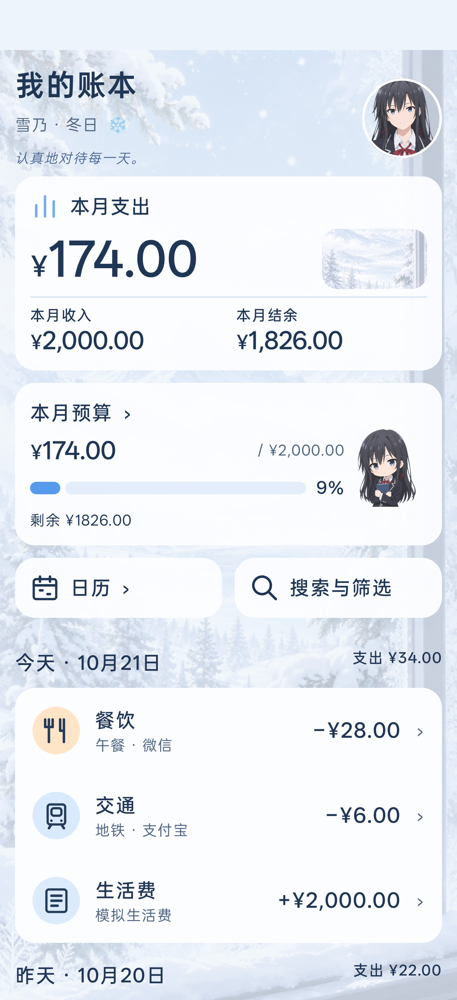
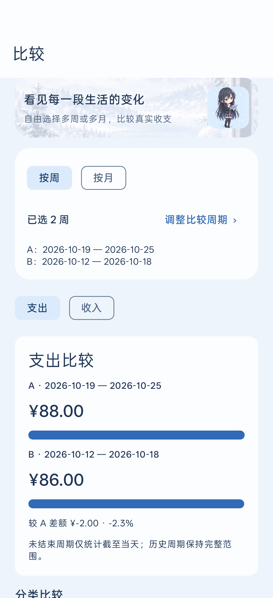
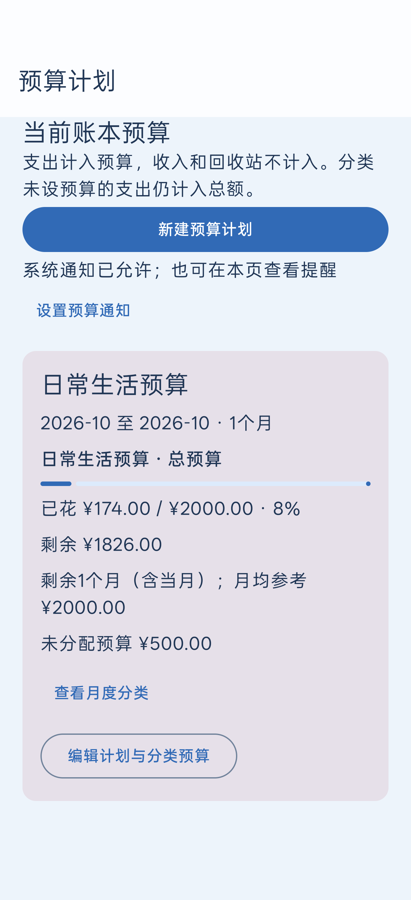

<div align="center">

# 个人记账 · Daily Ledger

**让分散的消费，回到一本账里。**

学校刷支付宝，外卖用微信，银行卡扣款又发来一条短信。<br>
少一点手动录入，也能看清钱花在哪里。

[**下载试用**](#下载安装) · [**看界面**](#界面预览) · [**提建议**](#你的一条反馈就能帮助改进)


</div>

我最初做这个软件，是因为学校使用支付宝，而平时买东西又常用微信。记录分散在不同地方，每次再手动抄一遍，很容易忘记。

Daily Ledger 尝试把这些可识别的支付信息整理进同一个账本：**明确且已获授权的消费自动记，不确定的由你确认。** 日常账目保存在安卓手机，也可以备份到自己的 Windows 电脑。

## 界面预览

同一本账，可以清爽一点，也可以有自己的主题。

下面是 **0.7.10 界面组件在真机独立测试页面中的截图**，全部使用模拟账目；不是新版完整操作录屏，也未展示真实账号或系统通知。点击可看原图。

<table>
  <tr>
    <th>简洁首页</th>
    <th>冬日主题</th>
  </tr>
  <tr>
    <td><a href="docs/images/home-default.png"></a></td>
    <td><a href="docs/images/home-winter.png"></a></td>
  </tr>
  <tr>
    <th>收支比较</th>
    <th>预算计划</th>
  </tr>
  <tr>
    <td><a href="docs/images/comparison.png"></a></td>
    <td><a href="docs/images/budget.png"></a></td>
  </tr>
</table>

[截图来源与复现说明](docs/界面截图说明.md)。当前版本预算百分比在首页与预算页的取整方式不同，本例显示为9%与8%；金额一致，已记录待统一。

## 它想替你省下什么

| 你遇到的情况 | 在这里怎么处理 |
| :--- | :--- |
| 微信、支付宝、银行卡记录分散 | 识别支持的支付通知和银行短信，记录到指定账本；同笔来源明确对应时合并，不确定时待确认 |
| 每天买早餐，还要反复填名称与分类 | 设置商户、时间和渠道等规则；首次明确确认后，按你授予的范围自动记账，金额取实际交易值 |
| 想换手机，又想把备份留在自己手里 | 将账号账目备份到自己的电脑；新手机连接同一电脑、登录同一账号，找回已成功备份的数据 |

### 一笔早餐，怎样记下来

下面是功能流程示例，金额仅为举例：

1. 支付后，手机收到可识别的通知或银行短信，例如早餐 **¥8.50**。
2. 首次匹配规则时先待确认，你可以在通知中 **确认、修改名称或忽略**。
3. 之后同一商户再次符合你已授权的明确规则时，按实际金额自动入账。
4. 记错了可以修改或撤销，撤销后的账目进入回收站；模糊匹配继续由你核对。

**能识别到消息，才有机会自动记账。** 微信、支付宝应用内有账单，不代表手机一定收到了系统通知；没有通知或短信的消费可能漏记，目前还没有账单对账补漏功能。银行短信目前主要适配招商银行95555模板。

## 适合谁先试试

- 使用 Android 8.0 及以上手机，经常混用微信、支付宝支付。
- 想减少重复录入，也愿意核对不确定的交易。
- 希望日常账目保存在手机，并愿意用自己的 Windows 电脑做备份。

如果你期待所有消费都自动记录、电脑关闭后也能立即完成备份，目前还达不到。电脑外网备份需要电脑开机、程序运行；免费临时通道地址变化后可能需要重新扫码。

## 下载安装

**当前配套试用版：手机 0.7.14 + 电脑 0.7.14。** 可以先安装手机体验手动记账，再按需要配置电脑备份。

| 平台 | 下载 | 版本与安装方式 |
| :--- | :--- | :--- |
| Android 手机 | [下载手机 APK](https://github.com/wambiton/daily-ledger/releases/download/v0.7.14/PersonalLedger-Android-0.7.14.apk) | 0.7.14 · Android 8.0 及以上；已有用户覆盖安装 |
| Windows 电脑 | [下载电脑端 ZIP](https://github.com/wambiton/daily-ledger/releases/download/v0.7.14/PersonalLedger-Windows-0.7.14.zip) | 0.7.14 · 完整解压后运行 `LedgerBackup.exe` |

[查看发布页与全部附件](https://github.com/wambiton/daily-ledger/releases/tag/v0.7.14) · [安装说明](https://github.com/wambiton/daily-ledger/releases/download/v0.7.14/INSTALL.md) · [SHA-256 校验文件](https://github.com/wambiton/daily-ledger/releases/download/v0.7.14/SHA256SUMS.txt)

> 当前为试用发布，手机 APK 使用调试签名。手机 0.7.14 与电脑 0.7.14 是本次配套组合。升级请保留原有数据，不要先卸载手机应用；电脑 ZIP 中的 `_internal` 文件夹必须与 EXE 一起保留。银行短信支持已适配的招商银行95555模板；只处理开启后的新消息。

### 第一次体验

1. 用几笔模拟账目试试记账、日历、比较和预算。
2. 想体验自动记账时，在应用内指定账本并设置所需权限；无需为了测试额外消费。
3. 有备份需求时，按 [安装说明](https://github.com/wambiton/daily-ledger/releases/download/v0.7.14/INSTALL.md) 配置电脑，确认界面明确显示本次备份成功。

QQ邮箱用于账号和验证码，**账目不保存在QQ邮箱里**。换手机只能找回已经成功上传到对应电脑的记录；“手机已保存”不等于“电脑备份成功”。完整步骤见 [备份使用说明](docs/电脑端外网备份使用说明.md)。

## 你的一条反馈就能帮助改进

这是一个从个人需要出发、持续改进的项目。不需要懂编程，告诉我一个不方便的地方就很有帮助：

- **自动记账**：你的手机或银行消息能识别吗？有没有漏记、重复或分类不合适？
- **日常使用**：记一笔账时，哪个步骤最麻烦？比较和预算有没有帮你看清支出？
- **电脑备份**：你能否看懂有没有备份成功？换机恢复的步骤哪里让你困惑？

[**反馈使用问题**](https://github.com/wambiton/daily-ledger/issues/new?template=bug_report.yml) · [**提出功能建议**](https://github.com/wambiton/daily-ledger/issues/new?template=feature_request.yml) · [看看其他人的反馈](https://github.com/wambiton/daily-ledger/issues)

提交时写上软件版本、设备型号、操作步骤和预期结果即可。反馈是公开的，请遮盖邮箱、卡号和真实交易，不要上传数据库、密码或SMTP授权码。更多说明见 [试用与反馈指南](docs/试用与反馈指南.md)。

## 还有哪些日常功能

| 功能 | 可以做什么 |
| :--- | :--- |
| 记账与日历 | 收入/支出分类、补记和修改、按日期查看，在当前账本搜索筛选 |
| 多周与多月比较 | 自选不连续的周或月，查看总额与分类差异；每周固定周一到周日 |
| 预算 | 单月或连续多月计划、逐月分类分配，80%和100%提醒 |
| 导入与导出 | 预览后追加手机账目，重复由你决定；Excel导出、JSON导入导出 |
| 回收站与恢复 | 删除账目保留30天；历史电脑备份可恢复为独立账本供核对 |
| 自动记录管理 | 查看来源、拆分误关联、恢复手动忽略记录、撤销入账 |

## 当前版本与下一步

**0.7.14 是试用版。** 手机与电脑配套支持智能命名规则备份。发布前已通过108项电脑端业务测试、41项服务端测试、6项电脑端测试，以及实际电脑程序的重启和备份专项。

新增通知操作仍待本轮真机锁屏、后台唤醒验证；公网连接和其他机型也未重新全面验收。测试通过不等于覆盖所有真实支付场景。具体执行日期与范围见 [开发进度](开发进度.md)。

接下来重点是完善通知体验、增加经验证的银行模板，以及实现账单对账补漏。欢迎通过上方反馈入口告诉我，哪一项最影响你的使用。

## 想了解实现或从源码运行

技术栈：**Kotlin / Jetpack Compose / Room / Python / Django**。以下内容供想看代码或参与排查的读者使用。

### 从源码运行

当前构建脚本主要面向 **Windows + JDK 17 + Python**。Android 最低支持 Android 8.0（API 26），这不代表已在所有品牌机型上验收。

```powershell
python scripts/bootstrap.py
./scripts/android.ps1 -Tasks @('assembleDebug','testDebugUnitTest','lintDebug')
```

构建脚本当前使用 `E:\jdk-17`，请先将 `scripts/android.ps1` 中的路径调整为自己的 JDK 17 位置。SDK、Gradle 与缓存下载到 `.tools`，不纳入 Git。中文路径通过 `R:` 别名兼容；该盘符已被占用时脚本会停止。

APK 输出：`android/app/build/outputs/apk/debug/app-debug.apk`。

服务端测试：

```powershell
python -m venv .venv
./.venv/Scripts/python.exe -m pip install -r server/requirements.txt
./.venv/Scripts/python.exe server/manage.py migrate
./.venv/Scripts/python.exe server/manage.py test ledger
./.venv/Scripts/python.exe scripts/smoke_server.py
```

开发测试默认使用 SQLite。部署服务时应配置独立密钥与适当的网络设置，不直接公开开发配置。桌面端依赖见 `desktop/requirements.txt`，打包入口见 `scripts/build_desktop.py`。

## 项目结构

```text
android/      Android 应用、Room 数据库、单元与真机测试
server/       账号和备份服务
desktop/      Windows 电脑备份界面
scripts/      构建、打包、诊断与测试脚本
docs/         设计、协议和使用文档
reports/      阶段验收记录（私有诊断不上传）
```

## 开发文档

| 文档 | 内容 |
| :--- | :--- |
| [产品需求](PRD.md) | 产品目标和基础需求 |
| [开发计划](开发计划.md) | 分阶段实施安排 |
| [开发进度](开发进度.md) | 实际测试结果、已知限制和阶段记录 |
| [备份使用说明](docs/电脑端外网备份使用说明.md) | 安装、邮箱设置、配对、备份与恢复 |
| [主题设计](docs/主题切换与冬日主题.md) | 外观切换与主题说明 |
| [问题反馈指南](CONTRIBUTING.md) | 如何提供可复现的问题信息 |

## 隐私与素材

源码仓库不用于保存账目、数据库、SMTP 授权码、签名密钥或私人诊断截图。反馈时请使用模拟数据，并遮盖邮箱、卡号、验证码和交易信息。

主题中涉及的动漫角色与相关素材不表示本项目拥有其原始角色版权；公开源码也不代表授予这些素材的商业使用权。项目尚未声明开源许可证，使用或再分发前请先确认授权范围。
