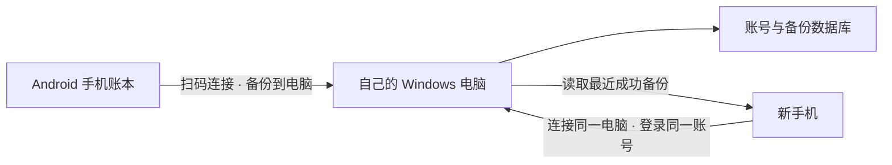

<div align="center">

# 个人记账 · Daily Ledger

**认真记录每一天，让收支与预算更清晰。**

Android 本地记账 · 多周期比较 · 预算提醒 · 自己电脑上的备份


[下载安装](#下载安装) · [功能介绍](#功能介绍) · [快速开始](#快速开始) · [开发文档](#开发文档) · [反馈问题](https://github.com/wambiton/daliy-app/issues/new/choose)

</div>

---

从校园里交替使用微信和支付宝的日常出发，这个项目希望让记账更方便：随手记录收入与支出，比较不同周、不同月的开销，再把账目备份到自己的电脑。

日常记账保存在手机本地；电脑端负责账号服务与备份。QQ 邮箱用于账号注册、登录及验证码，**账目不是保存在 QQ 邮箱里**。

## 欢迎试用与提建议

这是一个由日常需求出发、持续改进的个人项目，目前希望邀请少量用户试用，重点收集**记账是否顺手、自动记账是否漏记、电脑备份是否清楚可靠**的反馈。不需要懂编程，也欢迎只反馈一个不方便的地方。

**[下载手机与电脑端](#下载安装) · [报告问题](https://github.com/wambiton/daliy-app/issues/new?template=bug_report.yml) · [提出功能建议](https://github.com/wambiton/daliy-app/issues/new?template=feature_request.yml)**

第一次试用可按这个顺序：

1. 安装手机端，用几笔模拟账目体验记账、日历、比较与预算。
2. 有备份需求时，再配置自己的电脑端并检查“本次备份成功”。
3. 发现问题时登录 GitHub，选择上面的反馈入口，填写版本、设备和操作步骤。

试用前请阅读 [试用与反馈指南](docs/试用与反馈指南.md)。重要账目请另留备份；不要为了验证自动记账额外消费。反馈是公开的，请遮盖邮箱、银行卡号及真实交易信息，不要上传数据库、密码或SMTP授权码。

## 下载安装

| 平台 | 下载 | 版本与安装方式 |
| :--- | :--- | :--- |
| Android 手机 | [下载手机 APK](https://github.com/wambiton/daliy-app/releases/download/v0.7.10/PersonalLedger-Android-0.7.10.apk) | 0.7.10 · Android 8.0 及以上；已有用户覆盖安装 |
| Windows 电脑 | [下载电脑端 ZIP](https://github.com/wambiton/daliy-app/releases/download/v0.7.10/PersonalLedger-Windows-0.7.0.zip) | 0.7.0 · 完整解压后运行 `LedgerBackup.exe` |

[查看发布页与全部附件](https://github.com/wambiton/daliy-app/releases/tag/v0.7.10) · [安装说明](https://github.com/wambiton/daliy-app/releases/download/v0.7.10/INSTALL.md) · [SHA-256 校验文件](https://github.com/wambiton/daliy-app/releases/download/v0.7.10/SHA256SUMS.txt)

> 当前为试用发布，手机 APK 使用调试签名。手机 0.7.10 与电脑 0.7.0 是本次配套组合。升级请保留原有数据，不要先卸载手机应用；电脑 ZIP 中的 `_internal` 文件夹必须与 EXE 一起保留。银行短信自动记账尚未接入。

## 功能介绍

| 功能 | 当前能力 |
| :--- | :--- |
| 日常记账 | 收入、支出、分类、备注、补记与修改，人民币精确到分 |
| 日历与检索 | 按日期查看账目，在当前账本内搜索与筛选 |
| 多周期比较 | 自选多周或多月，支持分类比较，周一至周日为一周 |
| 预算计划 | 单月或连续多月总预算、每月分类分配，80% / 100% 阈值提醒 |
| 账本与导入 | 独立账号账本，预览后追加导入手机账目，重复记录由用户选择 |
| 文件与回收站 | Excel 导出、JSON 导入导出、删除后保留 30 天的回收站 |
| 电脑备份 | 扫码连接自己的 Windows 电脑、手动上传、换机登录恢复已备份账目 |
| 自动记账 | 识别支持的微信、支付宝系统通知，提供待确认记录与连接状态 |
| 外观主题 | 默认简洁主题与冬日主题，共用账本、比较和个人中心布局 |

> 自动记账依赖系统实际发出的通知、通知使用权和手机后台设置，并不保证识别所有支付。银行短信识别与跨来源重复合并仍在开发，当前版本尚未接入。

## 数据如何保存



- 不备份也能在原手机继续记账；换机只能恢复已成功上传的记录。
- 外网连接使用免费临时通道；电脑需开机并运行服务，地址变化后需重新扫码。
- 每位用户可以运行自己的电脑端，账号与账目保存在对应电脑。
- “手机已保存”和“电脑备份成功”是两个状态，请以本次备份结果为准。

## 快速开始

### 使用交付包

配套安装包见上方“下载安装”或 GitHub Releases，安装包不纳入源码 Git 历史。手机 APK 覆盖安装时请保留数据；电脑端应完整解压，不能只复制 EXE。

按照 [电脑端外网备份使用说明](docs/电脑端外网备份使用说明.md) 配置自己的发信邮箱、启动服务并扫码连接。升级前保留手机与电脑原有数据，不要卸载应用或删除账号目录。

### 从源码运行

当前构建脚本主要面向 **Windows + JDK 17 + Python**。Android 最低支持 Android 8.0（API 26），这不代表已在所有品牌机型上验收。

```powershell
python scripts/bootstrap.py
./scripts/android.ps1 -Tasks assembleDebug,testDebugUnitTest,lintDebug
```

构建脚本当前使用 `E:\jdk-17`，请先将 `scripts/android.ps1` 中的路径调整为自己的 JDK 17 位置。SDK、Gradle 与缓存下载到 `.tools`，不纳入 Git。中文路径通过 `R:` 别名兼容；该盘符已被占用时脚本会停止。

APK 输出：`android/app/build/outputs/apk/debug/app-debug.apk`。

服务端测试：

```powershell
python -m venv .venv
./.venv/Scripts/python.exe -m pip install -r server/requirements.txt
./.venv/Scripts/python.exe server/manage.py migrate
./.venv/Scripts/python.exe server/manage.py test ledger
./.venv/Scripts/python.exe scripts/smoke_server.py
```

开发测试默认使用 SQLite。部署服务时应配置独立密钥与适当的网络设置，不直接公开开发配置。桌面端依赖见 `desktop/requirements.txt`，打包入口见 `scripts/build_desktop.py`。

## 项目结构

```text
android/      Android 应用、Room 数据库、单元与真机测试
server/       账号和备份服务
desktop/      Windows 电脑备份界面
scripts/      构建、打包、诊断与测试脚本
docs/         设计、协议和使用文档
reports/      阶段验收记录（私有诊断不上传）
```

## 开发文档

| 文档 | 内容 |
| :--- | :--- |
| [产品需求](PRD.md) | 产品目标和基础需求 |
| [开发计划](开发计划.md) | 分阶段实施安排 |
| [开发进度](开发进度.md) | 实际测试结果、已知限制和阶段记录 |
| [备份使用说明](docs/电脑端外网备份使用说明.md) | 安装、邮箱设置、配对、备份与恢复 |
| [主题设计](docs/主题切换与冬日主题.md) | 外观切换与主题说明 |
| [问题反馈指南](CONTRIBUTING.md) | 如何提供可复现的问题信息 |

## 当前进展

手机端当前版本标识为 `0.7.10-capture-status`。已实现首页自动记账状态展示；近期验收覆盖构建、单元测试与真机流程，具体数量和执行日期以开发进度为准，不将历史测试结果当作每次提交的结果。

后续重点：银行短信识别、微信/支付宝与银行卡消息的重复合并，以及真实支付场景的持续验证。

## 隐私与素材

源码仓库不用于保存账目、数据库、SMTP 授权码、签名密钥或私人诊断截图。反馈时请使用模拟数据，并遮盖邮箱、卡号、验证码和交易信息。

主题中涉及的动漫角色与相关素材不表示本项目拥有其原始角色版权；公开源码也不代表授予这些素材的商业使用权。项目尚未声明开源许可证，使用或再分发前请先确认授权范围。
