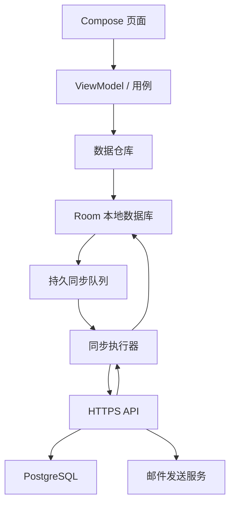

# 个人记账安卓应用完整开发计划

2026-09-10方案调整：账号改为QQ邮箱+应用密码，P5改为用户手动备份到电脑及恢复，外网入口暂缓。本文旧的自动同步/用户名登录描述不再作为本阶段验收要求；现行界面与操作见 [账号与手动电脑备份](docs/账号与手动电脑备份.md)。
- 版本：V1.0
- 日期：2026-09-07
- 依据：[PRD.md](./PRD.md)、[页面结构与交互设计.md](./页面结构与交互设计.md)
- 当前状态：开发规划完成，尚未编写应用代码或开通云端服务。
- 执行原则：先把本地记账做稳定，再完成账号、云端同步与恢复。第一代交付必须包含云端功能，本地版本只是中间里程碑。
- 本文中的技术选型、工期、配色及尚未确认的细节属于建议方案，不改写已确认的需求。

## 1. 第一代交付目标

交付一款可安装到用户安卓手机上的个人记账应用，以及配套云端服务。

| 模块 | 必须完成的内容 |
| --- | --- |
| 记账 | 收入、支出；先选分类；人民币两位小数；日期补记；选填备注；编辑、删除 |
| 分类 | 默认分类、自建分类，收入和支出分别管理 |
| 每日查看 | 顶部今日账目，日历选择其他日期，每日收支合计 |
| 比较 | 任意多周、任意多月，总额及分类比较，数字与图表 |
| 统计周期 | 周一至周日、自然月；当前周期截至当天 |
| 账号 | 用户名密码注册登录，绑定 QQ 邮箱，邮箱验证与密码恢复 |
| 数据 | 本地离线可用，联网自动同步，换机及重装后恢复已备份数据 |
| 界面 | 简洁清爽的默认风格，统一样式，为未来主题扩展保留空间 |

不纳入第一代：自动读取支付宝或微信账单、自动记账、主题切换或主题商店、预算、社交、理财、支付账户余额管理。分类改名和删除尚未确认，暂不纳入开发任务。

## 2. 建议技术方案

### 2.1 安卓客户端

| 项目 | 建议 | 用途 |
| --- | --- | --- |
| 语言 | Kotlin | 原生安卓开发 |
| 页面 | Jetpack Compose | 实现账本、日历、表单、图表和主题样式 |
| 页面状态 | ViewModel + Flow | 页面随本地账目变化更新 |
| 本地数据库 | Room | 持久保存账目、分类及同步队列 |
| 异步处理 | Kotlin Coroutines | 数据访问及网络请求 |
| 后台同步 | WorkManager | 在满足联网条件时处理持久同步任务 |
| 网络 | Retrofit / OkHttp | 调用账号及同步接口 |
| 设置 | DataStore | 保存界面偏好，不能作为明文密码仓库 |
| 图表 | Compose 绘制简单柱状图、横条图 | 第一代只需要清晰的金额对比 |

本项目仅面向安卓，优先使用原生方案，方便处理本地数据库、系统生命周期和后台任务。官方离线优先指南支持以本地数据源驱动页面，并通过持久任务处理联网同步；本计划据此组织数据层。[Android 离线优先指南](https://developer.android.com/topic/architecture/data-layer/offline-first)

暂定最低支持 Android 8.0；开始构建前核对用户实际手机系统，并调整兼容范围。编译 SDK、目标 SDK 与库版本在初始化时核对兼容矩阵，选用当时稳定版本并锁定，不在计划里虚构版本号。

### 2.2 云端服务

- 建议使用 Python + Django 构建单体 API 服务，PostgreSQL 保存账号、账目、分类和同步变更。
- 使用成熟的认证及密码哈希机制，不自行设计密码加密算法。Django 提供可扩展用户模型及认证机制，可作为用户名、QQ 邮箱账号体系的基础。[Django 认证扩展文档](https://docs.djangoproject.com/en/6.1/topics/auth/customizing/)
- 邮件通过服务端配置的发信服务发送，接收邮箱第一代限定 QQ 邮箱。用户无需提供自己的 QQ 邮箱密码。
- 使用 HTTPS；开发、测试、正式环境分离；数据库迁移纳入版本管理。
- 初期使用一个应用服务和一个数据库，不引入微服务。邮件发送使用可重试任务，具体任务组件在接口设计时确定。
- 云服务商、部署地区、域名、邮件服务及付费规格尚未选择。先完成可本地运行的服务，购买或正式部署前列出具体费用和配置。

### 2.3 架构与代码组织

建议目录职责：android 为安卓工程，server 为服务端，docs 为后续接口与测试文档，ops 为部署与恢复说明。已有三份产品文档保留当前位置。

安卓内部按 account、ledger、category、comparison、sync 和公共 UI 组织；业务层处理金额与周期，页面不直接编写数据库或同步逻辑。第一代避免拆分过多构建模块。

## 3. 视觉与页面任务

### 3.1 默认视觉建议

用户无特定主色偏好，按简洁原则选用浅灰背景、白色内容区、深灰文字，以及少量低饱和蓝色强调。

| 样式 | 初始设计值 |
| --- | --- |
| 页面背景 | #F6F7F9 |
| 内容背景 | #FFFFFF |
| 主要文字 | #1F2937 |
| 次要文字 | #667085 |
| 强调色 | #3563D9 |
| 边界线 | #E5E7EB |

这些是待视觉验证的初始值。统一定义颜色、字号、间距、圆角，避免逐页写死。收入支出同时使用正负号与文字；图表 A/B 同时使用标签与颜色。检查字体放大、文本对比和小屏可用性。

### 3.2 页面清单

| 编号 | 页面或组件 | 开发重点 |
| --- | --- | --- |
| UI-01 | 账本首页 | 今日区域、日历、历史日详情、记账入口 |
| UI-02 | 分类选择 | 收支切换、必须主动选分类、新建入口 |
| UI-03 | 金额表单 | 两位小数、日期、备注、草稿返回提示 |
| UI-04 | 账目详情与编辑 | 预填、日期迁移、删除确认 |
| UI-05 | 比较页 | 周/月切换、多个周期添加、修改与移除、收支切换 |
| UI-06 | 周期选择器 | 周一至周日、跨月跨年、任意月份 |
| UI-07 | 分类比较明细 | 所有已选周期金额及对应账目 |
| UI-08 | 我的与分类管理 | 自建分类、账号与同步状态入口 |
| UI-09 | 注册与登录 | 用户名密码、QQ 邮箱验证码 |
| UI-10 | 密码恢复与修改 | 验证、重置、会话失效处理 |
| UI-11 | 云端备份与恢复 | 进度、待同步数量、重试、冲突处理 |

先制作关键页面静态视觉稿，再在开发里落实。金额键盘、月份切换、长备注、无数据、加载失败状态同时设计，不能只做有数据的正常页面。

## 4. 数据模型与业务规则

### 4.1 主要实体

| 实体 | 核心字段 | 约束 |
| --- | --- | --- |
| 用户 | user_id、username、email、password_hash、verified_at | 用户名唯一，邮箱唯一；密码仅服务端保存哈希 |
| 分类 | category_id、user_id、type、name、default_key、version | 类型为收入或支出；同用户同类型名称唯一 |
| 账目 | entry_id、user_id、type、category_id、amount_fen、entry_date、note、created_at、updated_at、version、deleted_at | 分类类型必须一致，金额正整数分 |
| 本地待同步操作 | operation_id、user_id、entity_id、action、base_version、payload、status、retry_count | 与本地账目修改同事务写入 |
| 同步游标 | user_id、cursor、last_success_at | 只有对应变更落库成功后推进 |
| 服务端变更日志 | sequence、user_id、entity_id、version、action、payload | 支持按账号分页增量拉取 |
| 邮箱验证记录 | purpose、email、code_hash、expires_at、attempt_count、used_at | 验证码有有效期、次数限制且单次使用 |
| 登录会话 | session_id、user_id、refresh_token_hash、expires_at、revoked_at | 支持退出及密码重置后撤销 |

默认分类使用稳定标识，重复初始化、重装及多设备同步不能生成多套默认分类。账目和自定义分类在离线创建时即可生成全局唯一 ID。

### 4.2 金额与输入

- 数据库存整数“分”，例如 ¥18.50 保存为 1850；计算不使用浮点金额。
- 前后端执行同样的金额与分类校验，拒绝零金额、负金额和超过两位小数的输入。
- 暂建议单笔上限 ¥999,999,999.99，备注 500 字、分类名 20 字；这是技术边界建议，开始编码时固定到规则文档。
- 金额聚合使用足够大的整数类型并检查溢出；显示统一补足两位小数。
- 删除使用删除标记参与同步，正常查询排除已删除账目。

### 4.3 日期和统计口径

- 账目所属日期保存为独立日历日期，创建/修改时间保存 UTC 时间戳；不能使用同步时间决定账目属于哪天。
- 默认业务时区建议 Asia/Shanghai，所有“今天”和当前周期截止使用一致口径。
- 周范围从周一开始，到下周一之前；月范围从月初到下月初之前。
- 当前周期截止到今天结束；完整历史周期使用全部日期，不自动缩短为与当前周期相同天数。
- 总额、分类金额、明细与图表使用同一聚合结果，避免分别计算造成不一致。
- 差额 A−B；比例基准 B；B=0 时不计算百分比；无数据分类补零。
- 补记与编辑后，重新更新受影响日期、周和月的显示数据。
- 建议第一代不允许未来日期记账和选择全未来周期，因为暂不提供计划账目；该边界仍属建议，进入表单实现前再明确。

## 5. 账号与接口计划

### 5.1 账号流程

1. 注册：填写用户名与 QQ 邮箱，发送验证码；验证后设置密码并创建账号。
2. 登录：用户名和密码换取会话，客户端保存受系统密钥保护的令牌，不保存密码。
3. 找回：向绑定邮箱发送重置验证码，验证后修改密码并撤销旧会话。
4. 离线：已登录设备可使用本地账本；过期会话需要联网续期或重新登录才能同步。
5. 重新登录：恢复同一账号的本地待同步操作，不把其他账号的队列上传。

建议用户名 4—32 位字母、数字、下划线，密码至少8个字符，不限制字符类型且允许粘贴；邮箱首期只接受 @qq.com，QQ 邮箱别名需另行确认。验证码建议 10 分钟有效、60 秒重发间隔、单码最多 5 次尝试；服务端再按账号、邮箱与来源限制频率。这些数值在认证实现前形成最终配置。

### 5.2 API 清单（建议契约）

| 接口职责 | 主要请求与响应 |
| --- | --- |
| 发送验证码 | 邮箱、用途；通用发送结果与重试时间 |
| 注册 | 用户名、邮箱、验证码、密码；账号与会话 |
| 登录/刷新/退出 | 认证信息或刷新令牌；新会话或撤销结果 |
| 密码重置/修改 | 验证凭证及新密码；完成结果 |
| 获取本人资料 | 当前账号的用户名、脱敏邮箱 |
| 上传变更 | 操作 ID、实体 ID、基准版本、载荷；逐条成功/冲突/失败结果 |
| 拉取变更 | 游标与页大小；变更列表、下一游标、是否还有数据 |
| 首次恢复快照 | 分页快照与一致性水位；随后从水位继续拉取增量 |

所有业务接口从认证会话推导 user_id，不能信任客户端传入的所属账号。分类创建也走持久同步协议，确保离线创建分类后记账可完整上传。

接口文档必须定义字段、状态码、错误格式、分页、幂等、版本冲突和示例；首版用测试服务联调，不将假注册或假备份当成完成。

## 6. 离线、同步与恢复专项

### 6.1 本地优先

- 本地保存账目和新增同步操作必须在同一个数据库事务完成。
- 页面只展示已落本地库的数据；断网、关闭应用、重启手机后仍能查看。
- 同步任务在保存后、应用回到前台、网络恢复及手动重试时触发，使用单账号串行执行器避免并发上传冲突。
- 安卓可能延迟后台任务，因此“自动同步”不承诺锁屏后立即完成；前台主动触发补偿同步，并显示真实状态。

### 6.2 上传与下载

1. 检查会话并恢复未完成任务。
2. 先上传分类，再上传引用分类的账目；同一实体操作按顺序处理。
3. 每项带稳定 operation_id。服务端重复收到同一操作时返回原结果，不能再建一笔。
4. 客户端只确认已返回成功的操作；超时保持待重试，不能猜测失败或成功。
5. 拉取服务端增量，按版本合并；有本地待提交修改时保留本地内容并处理冲突。
6. 每页变更与游标在同一事务落地；中途终止可安全重试。
7. 全部完成且没有待处理操作时才显示“已同步”。

### 6.3 冲突策略

- 使用服务端版本号进行乐观并发检查，不采用手机时间判定谁覆盖谁。
- 基准版本不匹配时返回当前云端版本；保留本地草稿，标记为待处理冲突。
- 冲突界面展示“此设备”和“云端”的金额、日期、分类、备注，让用户选择保留哪份；选择本地时以最新版本重新提交。
- 修改与删除冲突也必须展示，不能自动让已删除账目复活。
- 冲突只暂停相关账目，其他无冲突操作继续同步。
- 同名分类冲突复用云端既有分类并重映射本地引用；不同类型不得合并。
- 冲突界面是支撑已要求的数据可靠性的设计建议，纳入云端阶段实现。

### 6.4 换机与重装恢复

- 首次登录读取一致性快照并分页保存，再拉取快照后的增量；失败保留进度并重试。
- 已有本地账目时合并，不整库覆盖；重复恢复不增加账目数量。
- 尚未上传的账目只存在原设备，卸载或设备损坏后不能依靠云端找回；在待备份状态和退出流程中准确说明。
- 删除标记首期不主动清理；以后如果清理，必须让过期游标客户端先完成安全全量对账，防止旧数据复活。

### 6.5 服务器备份

账号同步与服务器灾难备份分别实现。建议每日数据库备份、保留 30 天，凭据与备份限制访问；正式发布前完成一次从备份恢复到独立环境的演练。初始目标为最大可接受备份数据间隔 24 小时、恢复服务 4 小时以内，需根据部署配置实测，不作为当前承诺。

## 7. 分阶段任务与里程碑

估算前提：一名熟悉安卓与后端的开发者全职推进，按每周 5 个工作日估算；不含等待用户反馈、采购、邮件服务开通或应用商店审核。AI 辅助效率、现有经验和设备问题可能改变工期。

| 阶段 | 预计工作日 | 主要任务 | 交付与完成条件 |
| --- | --- | --- | --- |
| P0 细化设计 | 2—3 | 视觉稿、输入边界、默认分类、设备兼容、接口草案 | 关键页面与数据规则可直接用于实现 |
| P1 工程和数据基础 | 2—3 | 安卓/服务端工程、构建流程、数据库模型、样式、迁移框架 | 空应用可安装，本地数据库可迁移，服务测试环境可启动 |
| P2 本地记账 | 4—6 | 分类、记账、编辑删除、日历、今日展示、离线持久化 | 完全断网完成记账全流程，重启不丢失 |
| P3 周月比较 | 3—4 | 周/月选择、聚合、分类明细、柱状图、边界测试 | 任意周期、跨年与零基准结果正确 |
| P4 账号和云端接口 | 4—6 | 邮箱验证、注册登录、令牌、密码重置、权限、同步 API | 真实 QQ 邮箱收信，双账号隔离，接口测试通过 |
| P5 同步与恢复 | 5—8 | 队列、重试、版本冲突、分页恢复、同步状态 | 断网重连、超时重试、多设备修改、换机恢复通过 |
| P6 集成与真机测试 | 4—6 | UI 与无障碍、数据库升级、性能、备份恢复、安全验证 | 严重问题清零，签名候选 APK 可安装升级 |
| P7 试用和交付 | 2—3 | 修复试用问题、正式环境配置、签名发布、文档 | 完整验收，交付 APK、源码及运维说明 |

基础工作量合计 26—39 个工作日；建议额外预留 5—8 个工作日用于联调与意外问题，总体约 31—47 个工作日，即约 6—10 周。另安排至少 7 个自然日真实记账试用，尽量与最后阶段重叠；外部等待可能使日历工期更长。

里程碑顺序：

- M1：P2 完成，得到可安装的离线记账内测版。
- M2：P3 完成，得到完整本地记账与比较版。
- M3：P5 完成，得到包含真实账号、备份、恢复的功能完整版。
- M4：P7 完成，得到可长期试用的第一代正式交付版。

虽然账号功能在后续接入，P1 就要预留账号归属和同步字段。开发阶段测试数据使用隔离测试账号，正式版不开放未经规划的游客数据迁移。

## 8. 测试与验收计划

### 8.1 自动化重点

- 单元测试：金额换算、日期区间、比较差额、基准为零、分类并集。
- 数据库测试：原子写入、事务失败、软删除、数据迁移、聚合与明细一致性。
- 接口测试：认证、账号隔离、越权引用分类、输入校验、验证码失效与重放。
- 同步集成测试：重复操作、乱序响应、网络超时、分页中断、版本冲突、恢复幂等。
- 少量关键 UI 流程测试：先选分类、补记、编辑删除、任意周期选择、注册登录。

### 8.2 必测情形

| 编号 | 场景 | 验收结果 |
| --- | --- | --- |
| T01 | 输入 0.01、18、18.50 | 保存与显示准确，18 显示为 18.00 |
| T02 | 未选分类、三位小数、负数 | 拒绝无效输入，不产生账目 |
| T03 | 备注空白、中文、长文本 | 正常保存或明确提示长度限制 |
| T04 | 修改金额、类型、分类、日期 | 明细及所有受影响合计一致 |
| T05 | 2026-08-31 至 2026-09-06 | 作为完整跨月周统计 |
| T06 | 2025-12-29 至 2026-01-04 | 作为完整跨年周统计 |
| T07 | 闰年2月、1月对3月 | 月范围和合计正确 |
| T08 | 当前周期对完整历史周期 | 截止标记正确，不偷偷裁短另一周期 |
| T09 | 基准为零、两边均零、单边有分类 | 文案准确，无错误百分比 |
| T10 | 飞行模式新增后强制关闭再打开 | 本地账目与待同步队列仍存在 |
| T11 | 服务已保存但响应丢失 | 重试不重复创建 |
| T12 | 同步时又编辑同一账目 | 后续编辑不会被旧响应覆盖 |
| T13 | 两设备同时修改/一删一改 | 显示冲突并能解决，无静默丢失 |
| T14 | 恢复中途断网、重复恢复 | 可续传或安全重试，最终数量与金额一致 |
| T15 | 切换两个账号 | 账目、队列、请求完全隔离 |
| T16 | 密码重置后旧设备联网 | 旧会话失效，本地待同步数据保留 |
| T17 | 安装新版覆盖旧版 | 本地账目、分类和待同步状态保持 |
| T18 | 服务器备份恢复演练 | 独立环境恢复成功，抽样及总额核对通过 |

### 8.3 真机与性能

- 至少覆盖用户实际手机和另一档安卓环境；具体型号在开始测试前记录。
- 测试断网、弱网、后台、系统回收进程、重启、低存储空间及字体放大。
- 使用含多年日期和多分类的 10,000 笔测试数据；建议验收目标为本地保存反馈 300ms 内、日切换和比较加载 500ms 内，冷启动 2 秒内，以约定真机实测并记录。
- 列表分页或按日加载，避免每次进入页面读取全部账目。
- 后台同步不做持续轮询，不申请与记账无关的短信、通知读取或无障碍权限。

## 9. 发布、运行与交付

### 9.1 发布路径

第一代默认按个人使用的签名 APK 交付；公开应用商店上架不是当前已确认范围。正式包使用固定包名和妥善保管的签名密钥，以支持以后覆盖升级。

上线顺序：测试环境全量验收 → 数据备份与迁移演练 → 服务部署 → APK 安装验证 → 真实记账试用 → 修复 → 第一代交付。服务回滚和数据库迁移要一起设计，不能只回滚程序而忽略数据结构兼容。

### 9.2 运行安排

- 监控服务可用性、接口错误率、同步失败、邮件失败与备份结果。
- 日志只记录必要的操作 ID 和错误类别，不记录密码、验证码、完整令牌或账目备注。
- 管理凭据通过环境配置提供，不写入代码仓库或 APK。
- 初次部署列出应用服务器、数据库、邮件、域名和备份存储的实际费用；当前不提供未经供应商验证的报价。
- 发布前确认数据保存说明和账号生命周期处理；若转为对公众发布，再核对目标渠道的实际要求。

### 9.3 最终交付清单

- 可安装和升级的签名 APK、版本号与文件校验值。
- 安卓及服务端完整源码、依赖锁定信息、构建步骤。
- 数据库结构及迁移脚本、接口文档。
- 测试报告、真机结果、已知问题清单。
- 服务部署、回滚、备份和恢复操作说明。
- 用户使用说明：记账、比较、离线状态、密码恢复、换机恢复。
- 配置项清单及签名密钥保管说明，凭据单独安全交付。
- 更新后的 PRD 和设计文档，准确记录最终实现。

完成标准：全部第一代必需功能通过验收；无已知丢账、重复账、金额错误、账号串数据或无法恢复等严重问题；交付物可按说明重新构建、安装和运行。

## 10. 主要风险与安排

| 风险 | 处理安排 |
| --- | --- |
| 同步导致丢失或重复 | 原子队列、幂等操作、版本冲突和故障注入测试 |
| 后台被系统延迟 | 持久任务加前台补偿，明确待同步状态 |
| QQ 邮箱收信失败 | P4 早期用真实邮箱验证投递，提供重试与限频 |
| 首次恢复时云端仍有新修改 | 快照水位加增量拉取，防止遗漏 |
| 数据库升级损坏账目 | 迁移测试与升级前备份验证 |
| 当前周期比较被误读 | 显示完整范围和截至当天标记 |
| 功能越做越多 | 自动记账和主题扩展另立版本，不拖入首版 |
| 服务器费用或账号未准备 | 提前列出所需资源，本地模块先独立推进 |

## 11. 开工前默认安排与待补信息

为避免无关细节阻塞，暂用“个人记账”作为工作名称，使用本文中性配色，先按个人 APK 交付，分类采用设计稿的建议清单。开发阶段可按进度逐项确认，提问仍遵循一次一个问题。

| 事项 | 何时需要明确 | 未明确前可做的工作 |
| --- | --- | --- |
| 用户手机型号与安卓版本 | P0 结束前 | 页面设计、数据规则、接口草案 |
| 最终应用名和包名 | 工程初始化/正式签名前 | 使用临时工作名称整理设计 |
| QQ 邮箱别名、输入限制、未来日期规则 | 相应表单实现前 | 数据模型与主流程开发 |
| 云服务和邮件服务预算及账号 | P4 云端联调前 | 本地客户端与本地测试服务 |
| 冲突处理页面具体样式 | P5 前 | 队列、版本与接口测试 |

## 12. 后续升级路线

### 多主题

第一代统一样式定义；后续新增主题选择和偏好保存。主题只改变视觉，不改变金额、账目与统计逻辑。

### 自动记账

先另行研究可取得的数据来源、授权方式和准确率，再决定方案。不能假定能直接读取微信、支付宝交易数据。未来采集结果应先转为待确认账目，再复用现有记账入口校验，并新增来源标识与去重规则；这些功能不提前塞入第一代。

## 13. 技术参考

- [Android 离线优先架构](https://developer.android.com/topic/architecture/data-layer/offline-first)
- [Android 数据层指南](https://developer.android.com/topic/architecture/data-layer)
- [Django 自定义认证](https://docs.djangoproject.com/en/6.1/topics/auth/customizing/)

参考用于支撑架构方向；实际依赖版本及运行环境在开发初始化时再次核对。本计划无需购买服务即可先完成设计与本地开发准备。
