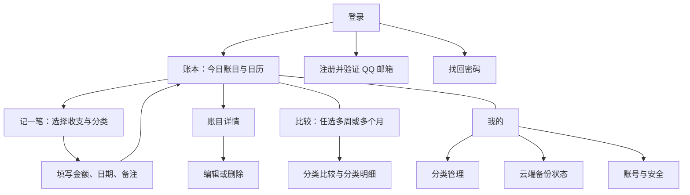

# 个人记账应用：页面结构与交互设计

2026-09-12方案调整：QQ邮箱+应用密码；首次注册自动带入本机账目；换机登录自动加载已备份账目，电脑不可达则等候、恢复连接后继续，可取消。“我的”只保留手动“备份到电脑”和追加“导入原本机账目”，备份状态直接显示。重复导入确认后新增相同账目并计入统计。原本机账本保留。外网入口暂缓。本文旧的自动同步/用户名登录描述不再作为本阶段验收要求；现行界面与操作见 [账号与手动电脑备份](docs/账号与手动电脑备份.md)。
- 版本：V1.0 设计初稿
- 日期：2026-09-07
- 需求依据：[PRD.md](./PRD.md)
- 阶段：页面结构与交互设计，不编写应用代码
- 说明：PRD 中已确认的需求保持有效。本文新增的布局、默认分类和边界处理均为设计建议，不代表用户已逐项确认。

## 1. 整体结构

底部设置三个入口：**账本、比较、我的**。账本页提供醒目的“记一笔”按钮，记账使用独立页面，完成后返回原页面。



## 2. 账本页

### 页面结构

从上到下排列：

1. 标题“账本”，右侧显示简短的同步状态。
2. 今日区域：今天的收入、支出合计，以及今天的账目列表。
3. 日历区域：月份切换、日期选择、“回到今天”。
4. 历史日期区域：仅在选择其他日期时出现，展示所选日期的收支合计及账目。
5. 固定在底部导航上方的“＋ 记一笔”按钮。
6. 底部导航：账本 / 比较 / 我的。

今日区域始终位于日历上方，符合“今天排在最上面”的要求。今天账目较多时，默认展示最近 3 笔，点击“展开今日账目”查看全部，避免日历被推得太远。选择今天时不再重复展示另一份今日列表。

### 静态线框

```text
┌──────────────────────────┐
│ 账本              已同步 │
│ 今天 · 9月7日            │
│ 收入 ¥100.00 支出 ¥28.50 │
│ 餐饮  午餐       -¥18.50 │
│ 交通  公交       -¥10.00 │
│ 生活费          +¥100.00 │
├──────────────────────────┤
│ ‹      2026年9月       ›  │
│ 一 二 三 四 五 六 日     │
│       月历日期网格       │
│               回到今天   │
├──────────────────────────┤
│ 9月5日 · 周六            │
│ 收入 ¥0.00 支出 ¥36.00   │
│ 餐饮  微信支付   -¥36.00 │
│                          │
│       ＋ 记一笔          │
│ 账本      比较      我的 │
└──────────────────────────┘
```

以上金额仅用于说明布局。

### 交互规则

- 默认选择今天；日历以周一为每行第一天。
- 今天使用描边，选中日期使用填充，存在账目的日期带圆点；不能只依赖颜色区分。
- 切换日期后更新历史日期区域，并滚动到该区域；今天的区域仍保留在页面顶部。
- 空日期显示“这一天还没有账目”，提供“补记这一天”按钮。
- 通用“记一笔”默认今天；“补记这一天”默认所选日期，金额页明确展示日期。
- 当天账目按录入顺序倒序展示；修改备注等内容不会重新排列账目。
- 点击账目打开详情，返回时保留日历选中日期和滚动位置。

## 3. 新增账目：先分类，再填写

### 第一步：选择分类

- 顶部标题“记一笔”，提供返回按钮。
- 切换项“支出 / 收入”，初始默认支出。
- 显示当前收支类型的分类网格，不预先选中分类。
- 点击分类直接进入第二步，满足必须先选择分类的要求。
- 网格末尾提供“＋ 新建分类”；创建后选中新分类并进入第二步。
- 收支类型切换时显示对应分类，不能沿用另一类型的分类。

### 第二步：填写账目

```text
┌──────────────────────────┐
│ ‹          记支出        │
│ 分类       餐饮       ›  │
│ 金额       ¥ 18.50       │
│ 日期       今天 9月7日 › │
│ 备注（选填）             │
│ 例如：午餐，支付宝支付   │
│                          │
│       数字输入键盘       │
│        保存账目          │
└──────────────────────────┘
```

- 进入页面后聚焦金额，打开数字键盘，允许小数点及最多两位小数。
- 金额必须大于 0；收入、支出由类型决定，不输入负数。此项为建议的录入规则。
- 保存后统一显示两位小数，例如输入 18，显示 ¥18.00。
- 日期可修改；备注可留空，不增加支付方式字段。
- 点击分类行可重新选择分类，保留已填写的金额、日期和备注。
- 保存按钮在提交时暂时禁用，避免连续点击产生重复账目。
- 本地保存成功即可返回账本并更新合计，不等待云端响应。
- 离线提示“已保存，联网后自动备份”；本地保存失败则留在页面并保留输入。
- 补记完成后显示对应日期的账目区域，便于确认。
- 有未保存内容时返回，询问“放弃本次编辑？”：继续编辑 / 放弃；无输入时直接返回。

## 4. 账目详情、编辑与删除

- 详情展示收支类型、分类、金额、日期和备注；空备注显示“未填写”。
- 底部提供“编辑”，右上角菜单提供“删除”。
- 编辑复用记账表单并预填原值。更改收支类型时必须重新选择对应分类。
- 删除前显示具体摘要，例如“删除这笔餐饮支出 ¥18.50？”；按钮为取消 / 删除。
- 修改或删除本地成功后，及时更新每日合计和比较结果，并排队同步到云端。
- 修改日期后账目归入新日期，原日期不再保留该账目。

## 5. 比较页

2026-09-09按用户要求扩展为多周期比较。

### 页面结构与选择

1. “按周 / 按月”切换，各自保留选择列表。
2. 默认本周与上周，或本月与上月；列表按选择顺序标记 A、B、C 等，各项可修改。
3. “添加一周 / 添加一个月”允许选择更多非相邻、跨年周期；可以移除，至少保留两个。
4. 周按周一至周日，选择任意一天确定所属周；月按自然月。禁止未来周期和重复周期。
5. “支出 / 收入”控制总额、分类金额与明细。
6. 各周期金额与横条纵向排列，带周期名称，数量较多时滚动查看。

### 统计与明细

- 以第一个周期 A 为基准，每个其他周期显示“该周期 − A”的差额，以及该差额除以 A 的百分比，保留一位小数。
- A 为零时不计算百分比，明确标记；移除 A 后新第一项成为基准。
- 未结束周期统计截至当天，历史周期保持完整范围。
- 分类取所有所选周期的分类并集；无记录的周期显示零金额，分类按各周期金额合计降序排列。
- 总额图表内部共用刻度；每个分类的各周期横条共用刻度。文字标明周期和金额，不依赖颜色。
- 点击分类后按已选周期顺序展示该分类账目，可打开账目详情。
- 所有周期均无数据时显示零合计和“所选周期暂无记录”。

## 6. 我的与分类管理

“我的”页面依次提供：用户名与绑定邮箱、云端备份、分类管理、账号与安全。

### 分类管理

- 收入、支出两个页签；展示默认分类和自定义分类。
- 新建分类填写名称即可，图标使用统一默认图标，减少第一代操作成本。
- 同一收支类型下禁止同名分类，名称去除首尾空格后不能为空。
- 建议默认支出：餐饮、电子物品、交通、日用品、学习、娱乐、其他支出。
- 建议默认收入：生活费、工资、兼职、红包、其他收入。
- 第一代先落实已确认的“创建分类”。分类改名、删除尚未确认，本稿不设置相应入口，避免误把额外功能纳入范围。

### 云端备份

- 展示最近成功同步时间、待同步数量和当前状态。
- 状态包括：已同步、正在同步、离线待同步、同步失败。
- 同步失败显示简短原因和“重试”，已保存在本地的账目仍可查看、编辑。
- 登录恢复期间显示进度与失败重试；恢复完成后进入账本。已有本地数据时使用合并同步，不能以整库覆盖的方式丢失本地记录。
- 页面使用“云端备份”表述，同时说明修改和删除也会同步；第一代不承诺历史版本回滚。
- 多设备同时修改同一账目的冲突规则需在技术设计阶段细化，不能静默丢弃待同步修改。

## 7. 注册、登录与密码恢复

### 登录页

- 输入用户名、密码；密码可切换显示或隐藏。
- 提供“登录”“注册账号”“忘记密码”。
- 密码错误提示“用户名或密码错误”，保留用户名。
- 首次登录、注册及密码恢复需要联网；已有有效本地登录状态时，离线可进入账本。

### 注册页

- 填写用户名、QQ 邮箱、邮箱验证码、密码、确认密码。
- 第一代建议将 QQ 邮箱范围限定为 `@qq.com`；其他 QQ 邮箱别名是否支持留待确认。
- 邮箱验证完成后创建账号，进入账本。
- 输入错误在对应字段下提示；验证码发送失败允许重试，成功后显示重发倒计时。

### 找回密码页

- 填写绑定的 QQ 邮箱并验证验证码。
- 验证通过后输入新密码并确认，完成后返回登录页。
- 用户名遗忘时，可在邮箱验证成功后提示对应用户名，具体服务规则在技术设计阶段落实。

### 账号与安全

- 展示用户名、脱敏 QQ 邮箱，以及修改密码、退出登录入口。
- 有待同步账目时退出登录，提示“还有账目未备份，请先同步”，保留本地数据，不自动清除。
- 同步完成后允许退出；不同账号的本地账目必须隔离。
- 邮箱更换、账号注销等账号生命周期细节尚未设计，需在对外发布前补充评估。

## 8. 通用交互与视觉方向

- 已确认：默认界面采用简洁清爽的风格，后续版本可提供多种主题。
- 用户无特定主色偏好；默认采用简洁的中性配色方向，具体建议见《开发计划》。
- 第一代建议采用浅色背景、适度留白、轻量分区和清晰的大号金额，减少装饰；具体配色和应用名称未定。
- 第一代不设置主题商店或主题切换入口。后续设计与开发时统一管理颜色、字体和圆角等样式，方便扩展主题；主题变化不改变记账流程与统计规则。
- 收入使用“＋”，支出使用“−”，结合文字与颜色区分。
- 图表用 A/B 标签区分周期，不用红绿暗示收入或支出变化一定是好或坏。
- Android 系统返回键先关闭键盘或弹层，再返回上一页；离开有未保存内容的表单时确认。
- 页面文字、触控区域和金额布局适配系统字体放大，长备注可换行。
- 网络错误不阻断已可用的本地记账和统计功能；本地数据读取失败则明确提示重试，不能伪装成无账目。
- 不增加预算、理财、社交、支付账户管理或自动读取支付账单入口。

## 9. 设计检查清单

| 场景 | 预期交互 |
| --- | --- |
| 今天首次记账 | 选择分类后填写金额，保存后今日合计更新 |
| 补记历史日期 | 日历选日，点击补记，表单日期继承所选日期 |
| 不填写备注 | 正常保存 |
| 离线新增、修改、删除 | 本地立即生效，显示待同步，联网后同步 |
| 修改账目日期 | 账目移至新日期，相关统计同步更新 |
| 本周与上月某周比较 | 独立选周，展示完整周一至周日范围 |
| 1月与3月比较 | 独立选择月份，数字和图表同时更新 |
| 切换收入比较 | 收入总额和收入分类一起更新 |
| 本月与完整月份比较 | 明确标注本月截至当天，不自动截短另一月份 |
| 对比基准为零 | 不发生除零，也不显示错误百分比 |
| 换手机登录 | 恢复已备份账目，展示进度与结果 |

## 10. 下一阶段

本稿完成了页面结构与主要交互方案。下一步可根据反馈制作界面视觉稿；开始应用开发前，还需确定云端服务、账号规则与同步冲突方案。

## 2026-09-13外网与电脑端补充

手机“我的”新增“扫码连接电脑”，扫码验证电脑身份；同电脑更新地址保留账号账本，不同电脑转到账号注册/登录。备份按钮启动后台任务，显示状态及“取消后台备份”；通知同样支持取消。相机和通知权限在使用时请求。

Windows窗口提供QQ邮箱SMTP配置、启动/停止外网连接、二维码、打开数据目录及各账号最新成功备份列表。关闭窗口缩到托盘，托盘菜单“打开窗口”“退出程序”；不添加开机启动。具体操作及试用限制见docs/电脑端外网备份使用说明.md。
